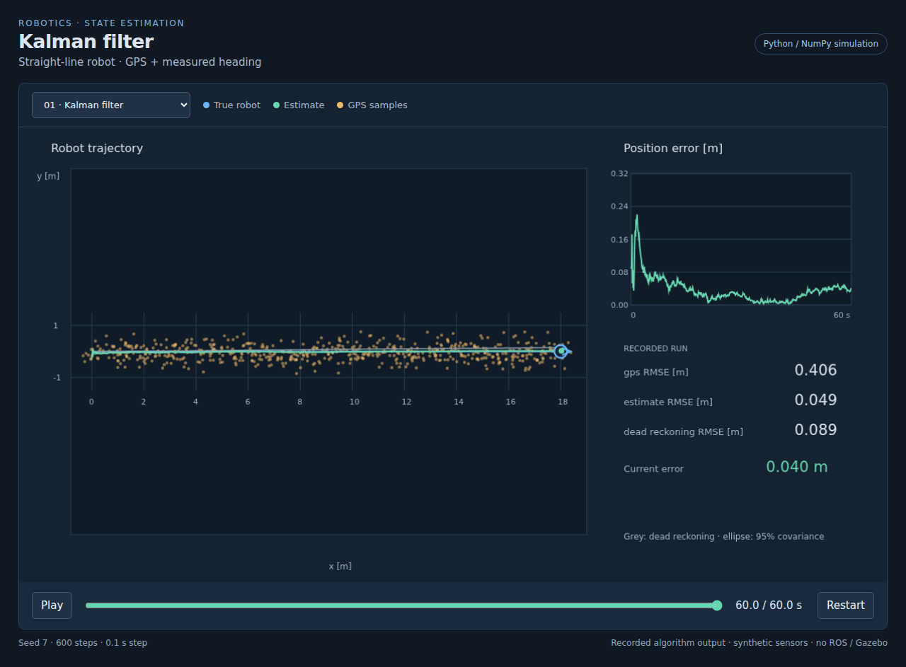
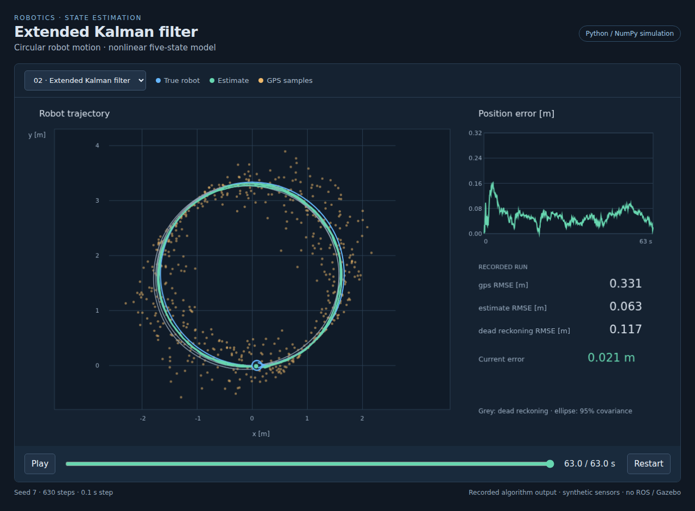
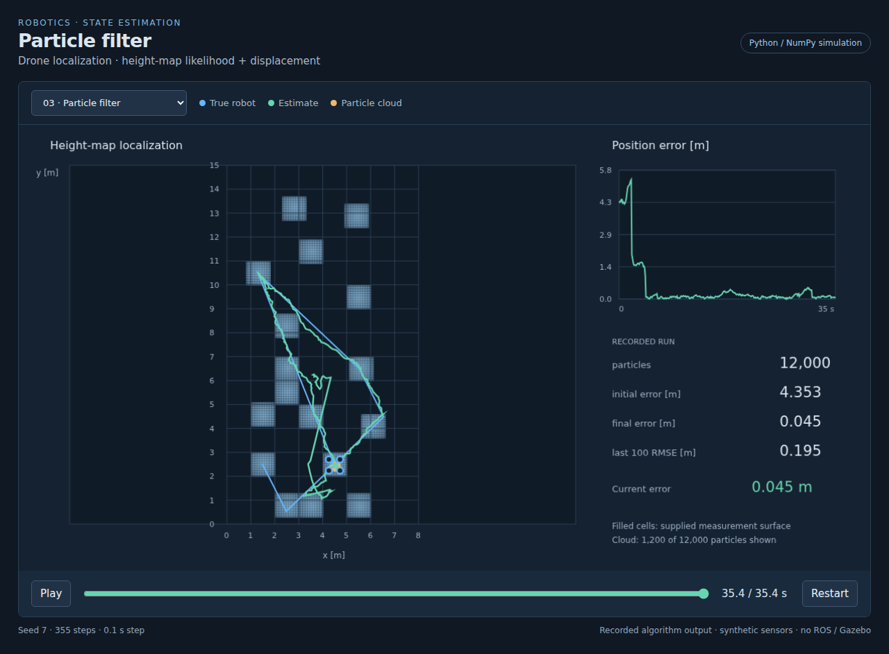

# Robotics localization assignments

Three state-estimation exercises from the University of Crete robotics course: localizing a ground robot with a Kalman filter, tracking circular motion with an Extended Kalman Filter, and locating a drone with a particle filter and height map.

**Python · NumPy · Bayesian filtering · ROS 1 interfaces · browser replay**

| Assignment | Engineering focus | Stack |
| --- | --- | --- |
| [01 · Kalman filter](assignments/01_kalman_filter) | GPS and heading fusion, uncertainty propagation | Python, NumPy, ROS `Odometry` |
| [02 · Extended Kalman filter](assignments/02_extended_kalman_filter) | Nonlinear arc motion, analytic Jacobian, velocity fusion | Python, NumPy, ROS sensor topics |
| [03 · Particle filter](assignments/03_particle_filter) | Global localization, map likelihood, systematic resampling | Python, NumPy, SDF world, ROS `PoseArray` |

## Run the collection

Python 3.10 or newer:

```sh
python3 -m pip install -r requirements.txt
python3 -m unittest discover -s tests -v
python3 tools/simulate.py
python3 -m http.server 8765 --bind 127.0.0.1
```

Open <http://127.0.0.1:8765/tools/viewer.html>. Select an assignment and use the timeline to replay the robot motion, sensor samples, estimates, and position error.

The screenshots below come from this running viewer and actual Python filter output, using synthetic sensors and seed 7. ROS/Gazebo execution has not been verified. [Setup, ROS commands, and validation scope](docs/SETUP.md) · [Technical brief report](docs/report.pdf) · [Overleaf ZIP](docs/report-overleaf.zip).

## 01 · Ground-robot Kalman filter

[](assignments/01_kalman_filter)

*A 60 s straight-line replay: position RMSE is 0.049 m versus 0.406 m for GPS. [Implementation and topics →](assignments/01_kalman_filter)*

## 02 · Extended Kalman filter

[](assignments/02_extended_kalman_filter)

*A 63 s circular-motion replay: position RMSE is 0.063 m versus 0.331 m for GPS. [Motion model and Jacobian →](assignments/02_extended_kalman_filter)*

## 03 · Drone particle filter

[](assignments/03_particle_filter)

*12,000 particles on the supplied 8 × 15 m assignment grid. Final position error is 0.045 m in this 35.4 s replay. [Map model and resampling →](assignments/03_particle_filter)*

These are reconstructed implementations of the course exercises, developed with AI coding assistance, rather than recovered original submissions. The sensor simulators, launch/RViz configurations, and drone world come from the CS-475 assignment materials by Michael Maravgakis. Their existing package metadata is retained. Results above describe the fixed synthetic scenarios, not physical-robot performance.
